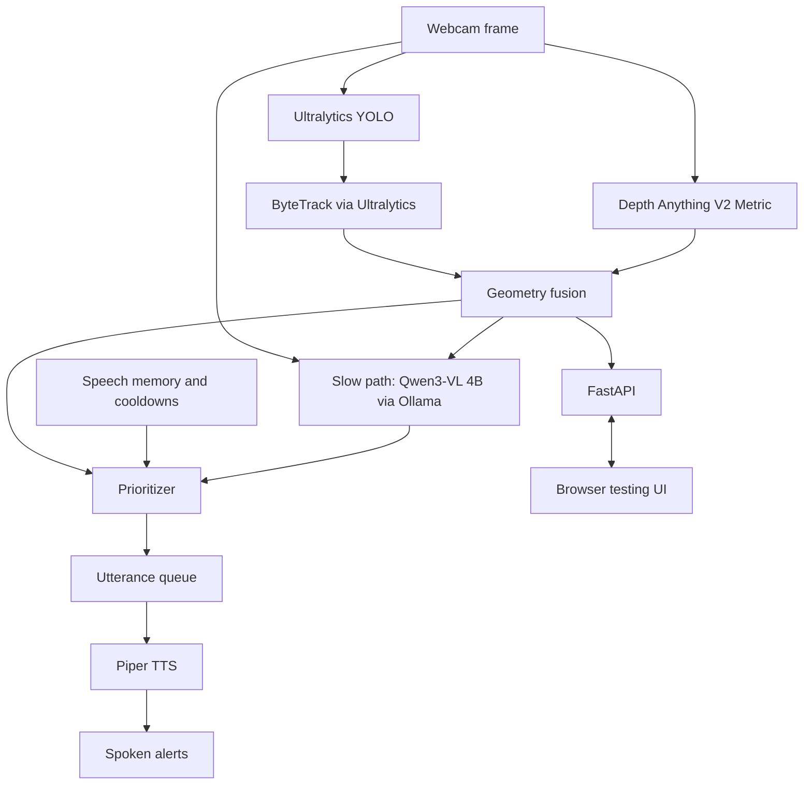

# VisionAssist

Offline AI-powered environmental awareness assistant for visually impaired individuals, built for the AI Hackathon 2026.

VisionAssist aims to turn live camera footage into timely spoken descriptions by detecting objects, estimating distances, tracking movement, and prioritizing relevant obstacles. Inference will run locally after initial setup, keeping camera footage on the local system.

## Current status

This repository currently contains only this README. The architecture and technology stack below describe the planned implementation. Source code, configuration, model assets, and frontend files have not been added. Dependency versions and startup commands will be documented when implementation begins.

## Planned architecture



The planned fast path will fuse tracked boxes and pixel depth into bearing, estimated meters, and approach flags. Python rules will score, filter, and rank observations. Speech memory will suppress repetition before an utterance queue feeds Piper.

The planned slow VLM path will receive an image and structured observations and return a JSON scene summary. It will add context without blocking immediate fast-path warnings. Contracts, timeouts, and calibration remain to be implemented.

## Planned APIs and libraries

| Component | API / library | Purpose |
| --- | --- | --- |
| Camera | OpenCV / WebRTC | Capture local or browser video |
| Detector | Ultralytics YOLO | Classes, boxes, confidence |
| Tracker | ByteTrack via Ultralytics | Stable IDs and track history |
| Depth | Depth Anything V2 Metric | Pixel depth estimates |
| Geometry | NumPy + OpenCV | Fuse position, depth, and movement |
| Speech memory | Python dictionaries | Recent alerts and cooldowns |
| Prioritizer | Custom Python logic | Rank relevant obstacles |
| Slow-path VLM | Qwen3-VL 4B via Ollama | Local scene interpretation |
| Text-to-speech | Piper TTS | Offline audio |
| Backend | Python + FastAPI | Connect pipeline to UI |
| Testing frontend | NVIDIA Live VLM WebUI | Planned dashboard customization |
| Communication | WebRTC and/or WebSockets | Video, observations, and status |

The ASUS Ascent GX10 (128 GB unified memory) will host inference. A laptop or phone will provide camera input and a browser interface over the local network. The prototype uses nearby computing hardware rather than wearable hardware.

## Repository contents

```text
README.md    Project overview, planned architecture, and hackathon goals
```

## Hackathon goals

1. Stream webcam frames to the GX10.
2. Detect and track objects with YOLO and ByteTrack.
3. Estimate depth and associate estimates with tracked objects.
4. Prioritize obstacles using explicit rules.
5. Add concise scene descriptions through Qwen3-VL.
6. Deliver offline spoken alerts.
7. Display detections, estimated distances, and inference latency in the browser.

Start with a functioning pretrained pipeline before attempting fine-tuning. Validate depth and tracking before using them for navigation decisions, including the effects of moving-camera motion.

## Example experience

On a sidewalk, the system detects a person and bicycle, tracks them, estimates their positions, and prioritizes relevant observations. An example alert is: “Bicycle ahead on your right, approximately two meters away.” This assumes calibrated and verified distance estimation. The VLM could add context such as a bicycle blocking an entrance.

## Safety and limitations

This is an experimental proof of concept, not a validated mobility or collision-avoidance device. Monocular depth may be unreliable without calibration, and camera motion can confuse tracking. It must not replace established mobility aids such as a cane or guide dog. Test in controlled, low-risk scenarios rather than relying on it for independent navigation.
