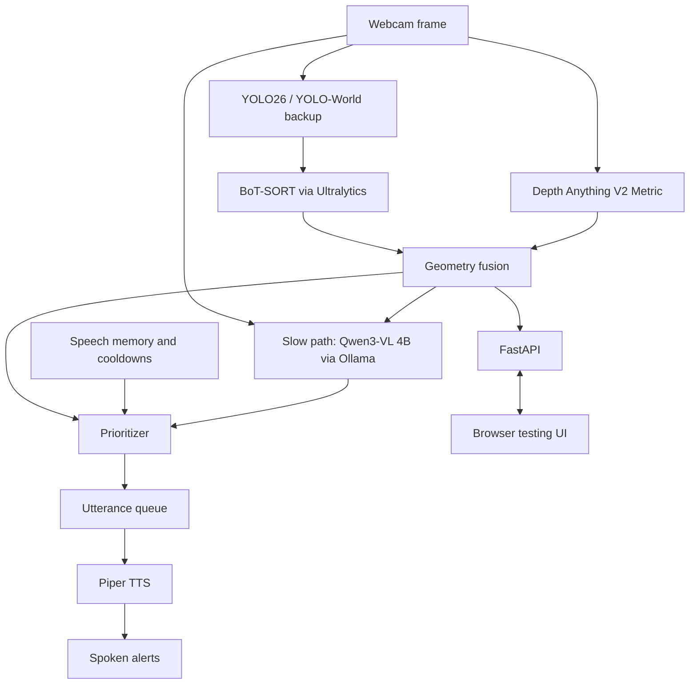

# VisionAssist

Offline AI-powered environmental awareness assistant for visually impaired individuals, built for the AI Hackathon 2026.

VisionAssist aims to turn live camera footage into timely spoken descriptions by detecting objects, estimating distances, tracking movement, and prioritizing relevant obstacles. Inference will run locally after initial setup, keeping camera footage on the local system.

## Current status

The YOLOdetection branch includes a simple desktop webcam demo using YOLO26 or YOLO-World, selected by the model setting, and OpenCV. It uses BoT-SORT to track separate objects and displays bounding boxes, track IDs, object labels, and confidence scores. Depth estimation, prioritization, speech, and the browser backend remain planned.

## Kokoro text-to-speech demo (TTS branch)

The standalone script `TTS/kokoro_tts.py` reads `TTS/inputtest.txt` and writes spoken audio to `TTS/output/output.wav`. Edit the text file, then run these commands from the repository root:

```powershell
python -m venv TTS/.venv
.\TTS\.venv\Scripts\python.exe -m pip install -r TTS/requirements.txt
.\TTS\.venv\Scripts\python.exe TTS/kokoro_tts.py
```

The TTS requirements constrain Transformers to version 4 for Kokoro 0.9.4 compatibility. Use the separate environment above to avoid changing the detector environment. It uses Kokoro's `af_heart` American English voice on the CPU and combines every generated chunk into one mono, 24 kHz WAV file. Open `TTS/output/output.wav` in an audio player to listen. Rerunning the script replaces that output file.

Optional input/output paths and speech speed:

```powershell
.\TTS\.venv\Scripts\python.exe TTS/kokoro_tts.py --input TTS/inputtest.txt --output TTS/output/message.wav --speed 1.1
```

Default paths are relative to the script, so `cd TTS` followed by `.\.venv\Scripts\python.exe kokoro_tts.py` also works. Explicit paths are relative to your terminal's current directory. Use an American English voice with this demo's `lang_code='a'`.

The first run needs internet access to download Kokoro model/voice assets and any missing English language resources. By default, Hugging Face assets are cached in `TTS/weights/huggingface/` (an existing `HF_HOME` environment variable takes precedence). Subsequent runs can use cached assets locally after setup. All files inside `TTS/output/`, along with downloaded weights, are excluded from Git. The script creates the output folder automatically when needed.

On Windows, install [eSpeak NG](https://github.com/espeak-ng/espeak-ng/releases) for English pronunciation fallback, especially unfamiliar words. Kokoro may warn and skip unknown words when that fallback is unavailable. The implementation follows the [official Kokoro Python usage](https://github.com/hexgrad/kokoro). This standalone demo is separate from the planned Piper integration.

Files: `TTS/kokoro_tts.py` (script), `TTS/inputtest.txt` (editable text), `TTS/requirements.txt` (dependencies), and `TTS/.gitignore` (local assets).

## Run the webcam demo

Use Python 3.10 or newer and Git (needed to install the CLIP dependency) on a computer with a camera and desktop display. From the repository root, enter the application folder and run:

```powershell
cd visionassist
python -m venv .venv
.\.venv\Scripts\python.exe -m pip install -r requirements.txt
.\.venv\Scripts\python.exe webcam_detection.py
```

A window shows the live camera with detected objects and their track IDs. Press **Q**, **Escape**, or close the window to exit. The camera is released on exit.

The first run downloads the selected model weights. YOLO26 defaults to `yolo26n.pt` and detects COCO's 80 classes. YOLO-World uses `yolov8s-worldv2.pt` plus CLIP text-encoder weights and supports the custom prompts in `labels.txt`. After downloading and caching the selected assets, inference runs locally. The demo does not estimate distance or navigation risk.

To choose another camera, change the confidence threshold, or use local model weights:

```powershell
.\.venv\Scripts\python.exe webcam_detection.py --model-type yolo26 --camera 1 --confidence 0.5 --model yolo26n.pt
```

If the camera cannot open, enable camera access in your operating system, close other camera applications, or try a different camera index. Install `opencv-python` with desktop GUI support rather than a headless OpenCV package.

## Object tracking and debugging

The default tracking profile is the custom [botsort.yaml](visionassist/botsort.yaml): 90 processed frames of lost-track retention, appearance-based ReID, and sparse optical-flow camera-motion compensation. Both model options continue using `persist=True`. No application-level identity matching is added.

The overlay includes stable session labels such as `person_1`, `person_2`, and `car_3`, confidence, visible tracked count, and smoothed processing FPS. The numeric suffix is the global tracker ID, not a per-class counter. If an ID's detected class changes, its first class-prefixed label stays fixed while the current class is reported separately in JSON. Detector-only observations have null IDs. Lost tracks retained in the buffer are not counted as currently visible objects.

```powershell
python webcam_detection.py --model-type yolo26 --profile reid --debug --json-output outputs/live.jsonl
python webcam_detection.py --model-type yolo26 --profile reid --track-buffer 120
python webcam_detection.py --model-type yolo26 --detect-only
```

`--model-type` overrides the comment switch for that run. `--detect-only` runs normal prediction without loading the tracking YAML or ReID encoder. `--debug` logs each frame's classes, IDs, confidence, boxes, counts, and FPS. Tracking configuration and Ultralytics version are printed at startup. An additional runtime record shows the resolved ReID model after tracker initialization.

### Profiles and settings

| Profile | Buffer | ReID | Configuration |
| --- | --- | --- | --- |
| `default` | Installed default (30 in 8.4.175) | False | Installed Ultralytics BoT-SORT YAML |
| `buffer` | 90 | False | Project YAML with ReID disabled |
| `reid` (default) | 90 | True | Project YAML |

Edit `botsort.yaml` for future experiments, or override its buffer with `--track-buffer`. The app creates a temporary effective YAML for each run and deletes it on exit; baseline runs load the package YAML explicitly to avoid shadowing it with the project file.

| Setting | Value | Meaning |
| --- | --- | --- |
| `track_buffer` | 90 | Keep lost tracks eligible for recovery for 90 processed frames, up from 30 |
| `with_reid` | True | Add appearance features to association |
| `model` | auto | Use native detector features when supported; otherwise Ultralytics selects a classification encoder |
| `gmc_method` | sparseOptFlow | Compensate estimated global camera motion |
| `proximity_thresh` | 0.5 | Spatial IoU gate before appearance matching |
| `appearance_thresh` | 0.8 | Appearance threshold used by Ultralytics' normalized embedding-distance implementation |
| `track_high_thresh` / `track_low_thresh` | 0.25 / 0.1 | First and second association-stage confidence thresholds, unchanged |
| `new_track_thresh` | 0.25 | New-track confidence threshold, unchanged |
| `match_thresh` | 0.8 | Association cost limit, unchanged |
| `fuse_score` | True | Include detection confidence in association, unchanged |

The existing detector confidence of 0.4 is preserved. It filters detections before tracking, so the tracker cannot recover low-confidence detections below 0.4 even though its low threshold is 0.1. Compare `--confidence 0.1` as a separate experiment if needed; this may increase false detections. Keep confidence identical across profile comparisons.

### Installed-version compatibility and limits

Verified against installed Ultralytics **8.4.175**, using its tracker implementation and the local YOLO26 checkpoint. Its YOLO26 detection head is non-end-to-end in the current prediction path and supports native `auto` features. The local YOLO-World head also satisfies the source-code compatibility check. Other weights, exports, or head settings may resolve `auto` to `yolo26n-cls.pt`, which requires an initial download/cache and adds inference cost. The runtime configuration log records that resolution.

In this installed implementation, appearance matching is rejected when the predicted track and detection do not meet the spatial gate. A larger buffer preserves the candidate but does not provide unrestricted matching anywhere in the image. Fast flicks, motion blur, large viewpoint changes, and a person returning elsewhere can still create new IDs. Sparse optical flow also needs useful visual overlap between frames.

The 90-frame buffer corresponds to about 3 seconds at 30 processed FPS or 9 seconds at 10 processed FPS. It is not a fixed wall-clock timeout. Retaining more candidates increases association work and can increase incorrect matches. ReID adds processing cost; similar clothing and overlapping people can still cause swaps. BoT-SORT combines appearance and IoU costs: rejecting an appearance match does not necessarily reject an otherwise acceptable IoU match. The appearance threshold is not a hard identity guarantee. IDs reset when the app restarts. These are session tracking IDs, not a person's real identity. No global appearance-only ID merging is performed, and reliable identity persistence is not guaranteed.

The integration follows the [Ultralytics tracking API](https://docs.ultralytics.com/modes/track/) and [BoT-SORT implementation](https://docs.ultralytics.com/reference/trackers/bot_sort/).

### Structured outputs

`--json-output` writes JSON Lines: a session record, a resolved tracking configuration record, then one record per processed frame. Frame records contain a source-video timestamp (or elapsed webcam time), frame index, smoothed processing FPS, inference-plus-tracking latency, visible tracked count, and objects with current class, class ID, numeric track ID, class-prefixed object ID, confidence, and pixel `bbox_xyxy`. This contract is ready for later depth and scene reasoning integration. No distance is fabricated. Output files are overwritten for each run, so choose distinct filenames.

### Check tracking settings

Run the webcam with `--profile default`, `--profile buffer`, or `--profile reid` to compare tracking settings manually. Try stationary viewing, slow movement, rapid camera flicks, and temporary occlusions. Watch whether the same physical subject retains its ID and whether different subjects incorrectly share an ID.

Use `--debug` or `--json-output` when you need frame records. The separate benchmark script, automated test files, and generated test outputs have been removed to keep the repository focused on the webcam application.

## Switch models

Near the top of `visionassist/webcam_detection.py`, keep exactly one setting uncommented:

```python
MODEL_TYPE, DEFAULT_MODEL = "yolo26", "yolo26n.pt"
# MODEL_TYPE, DEFAULT_MODEL = "world", "yolov8s-worldv2.pt"
```

To use the YOLO-World backup, comment the YOLO26 line and uncomment the World line, then restart the app. The model type, default weights, and custom-label handling switch together. `--model` can override the weights path; use weights matching the selected model type.

YOLO26 uses its trained categories and does not load `labels.txt`. Custom text prompts apply only to YOLO-World. The default model follows the [Ultralytics YOLO26 API](https://docs.ultralytics.com/models/yolo26/).

## Custom object labels (YOLO-World only)

[labels.txt](visionassist/labels.txt) contains the supplied custom vocabulary. The app reads one object name per line and ignores blank lines. It removes duplicate names and combines the prompts with all 80 COCO classes, because `set_classes()` replaces the active vocabulary.

Edit the labels to change the objects requested at startup, or select another file:

```powershell
.\.venv\Scripts\python.exe webcam_detection.py --labels my_labels.txt
```

A label file uses one object name per line, for example:

```text
sidewalk curb
traffic cone
electric scooter
```

The complete supplied list is enabled when YOLO-World is selected. For faster experiments and easier accuracy checks, use a smaller label file. Open-vocabulary prompts do not guarantee accurate detections, especially for flat surfaces, transparent objects, and object states.

The model and vocabulary configuration follow the [Ultralytics YOLO-World API](https://docs.ultralytics.com/models/yolo-world/).

## Planned architecture



The planned fast path will fuse tracked boxes and pixel depth into bearing, estimated meters, and approach flags. Python rules will score, filter, and rank observations. Speech memory will suppress repetition before an utterance queue feeds Piper.

The planned slow VLM path will receive an image and structured observations and return a JSON scene summary. It will add context without blocking immediate fast-path warnings. Contracts, timeouts, and calibration remain to be implemented.

## Planned APIs and libraries

| Component | API / library | Purpose |
| --- | --- | --- |
| Camera | OpenCV / WebRTC | Capture local or browser video |
| Detector | YOLO26 / YOLO-World backup | Classes, boxes, confidence |
| Tracker | BoT-SORT via Ultralytics | Stable IDs and track history |
| Depth | Depth Anything V2 Metric | Pixel depth estimates |
| Geometry | NumPy + OpenCV | Fuse position, depth, and movement |
| Speech memory | Python dictionaries | Recent alerts and cooldowns |
| Prioritizer | Custom Python logic | Rank relevant obstacles |
| Slow-path VLM | Qwen3-VL 4B via Ollama | Local scene interpretation |
| Text-to-speech | Piper TTS | Offline audio |
| Backend | Python + FastAPI | Connect pipeline to UI |
| Testing frontend | NVIDIA Live VLM WebUI | Planned dashboard customization |
| Communication | WebRTC and/or WebSockets | Video, observations, and status |

The ASUS Ascent GX10 (128 GB unified memory) will host inference. A laptop or phone will provide camera input and a browser interface over the local network. The prototype uses nearby computing hardware rather than wearable hardware.

## Repository contents

```text
repository/
  README.md
  visionassist/
    webcam_detection.py   Webcam application and model selection
    tracking_utils.py     Tracking profiles, JSON output, and debug overlay
    botsort.yaml          Editable BoT-SORT settings
    labels.txt            Custom YOLO-World labels
    requirements.txt      Python dependencies
    .gitignore            Generated files and model exclusions
    weights/
      yolo26n.pt          YOLO26 detector
      yolov8s-worldv2.pt   YOLO-World backup detector
      clip/
        ViT-B-32.pt       YOLO-World text encoder
```

All application files and model assets are bundled in `visionassist/`; the README stays at the repository root. Run the commands in this README from inside `visionassist/` after the initial `cd visionassist`. This also lets Ultralytics reuse the local `weights/clip/` cache. The app resolves simple detector filenames inside its `weights/` folder, and explicit `--model` paths remain supported. Model binaries are excluded from Git.

## Hackathon goals

1. Stream webcam frames to the GX10.
2. Detect and track objects with YOLO and BoT-SORT.
3. Estimate depth and associate estimates with tracked objects.
4. Prioritize obstacles using explicit rules.
5. Add concise scene descriptions through Qwen3-VL.
6. Deliver offline spoken alerts.
7. Display detections, estimated distances, and inference latency in the browser.

Start with a functioning pretrained pipeline before attempting fine-tuning. Validate depth and tracking before using them for navigation decisions, including the effects of moving-camera motion.

## Example experience

On a sidewalk, the system detects a person and bicycle, tracks them, estimates their positions, and prioritizes relevant observations. An example alert is: “Bicycle ahead on your right, approximately two meters away.” This assumes calibrated and verified distance estimation. The VLM could add context such as a bicycle blocking an entrance.

## Safety and limitations

This is an experimental proof of concept, not a validated mobility or collision-avoidance device. Monocular depth may be unreliable without calibration, and camera motion can confuse tracking. It must not replace established mobility aids such as a cane or guide dog. Test in controlled, low-risk scenarios rather than relying on it for independent navigation.
